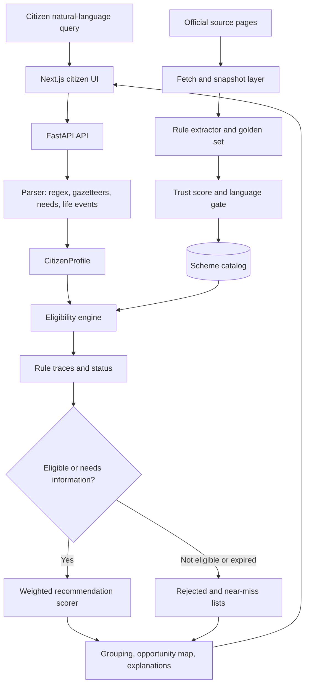
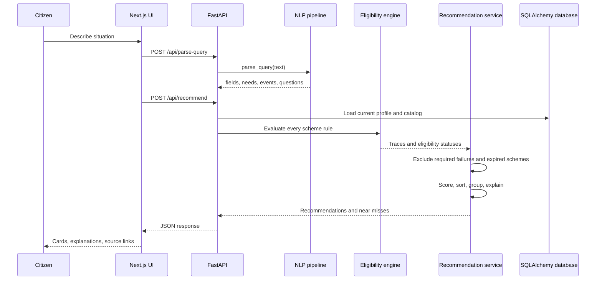

# CivicGuide: An NLP-Based Personalized Government Scheme Recommendation System with Eligibility-First Ranking and Explainable Decisions

**Author 1**, **Author 2**  
Department of **[Department Name]**, **[Institution Name]**  
**[City, Country]**  
`[author1@email]`, `[author2@email]`

> **Submission note.** This is an IEEE-style project report prepared from the implementation in this repository. Replace bracketed author, affiliation, and citation fields before submission. The repository contains no completed literature bibliography and no human evaluation dataset; those omissions are reported explicitly rather than filled with unsupported claims.

## Abstract

Citizens seeking government welfare schemes face a discovery problem before they face an eligibility problem. Scheme information is distributed across ministry and state portals, eligibility conditions are expressed in administrative language, and ordinary keyword or semantic search can rank a topically relevant scheme that the citizen cannot receive. CivicGuide is a prototype that addresses this problem with an eligibility-first recommendation pipeline. A natural-language query is converted into a structured citizen profile, need categories, and life events using deterministic extraction. Scheme rules are then evaluated by a rule-traced eligibility engine that returns eligible, likely eligible, needs more information, or not eligible. Only the non-rejected set is ranked using a weighted score combining eligibility strength, need relevance, location, income/profile fit, education/occupation fit, and usefulness. Semantic similarity is restricted to the need component and therefore cannot override a failed mandatory rule. Recommendations expose rule traces, source trust labels, near-miss results, and explanations of missing or failed criteria. The current catalog contains 71 records: 12 hand-verified schemes, four additional real schemes whose rules are pending confirmation, and 55 explicitly labeled demonstration records. Repository tests measured on 2026-09-15 include 92 passing backend tests and 18 passing discovery-module tests. Quantitative retrieval metrics, user studies, and a browser-based screenshot audit remain future work.

**Index Terms—** civic technology, government schemes, eligibility determination, explainable recommendation, natural-language processing, rule-based systems, information retrieval.

## I. Introduction

Government benefit programs are difficult to discover because the citizen must identify a relevant program and independently compare their circumstances with conditions such as age, income, residence, occupation, employment status, education, or disability. These tasks are especially difficult when the citizen describes a situation rather than a known scheme name, for example, “I lost my job and need skill training.”

Conventional directory search reduces the discovery burden but leaves eligibility assessment to the citizen. A content-based or embedding-based recommender improves topical matching but may amplify the central risk: a scheme can be highly similar to a query while being factually unavailable to the person who submitted it. CivicGuide therefore adopts a hard eligibility invariant: a scheme that fails a required rule cannot enter the primary recommendation list, regardless of semantic similarity.

The prototype makes four contributions:

1. A free-text processing pipeline that extracts citizen attributes, needs, and life events.
2. A deterministic eligibility engine with pass, fail, and unknown traces for every rule.
3. An eligibility-first multi-factor ranker with exact configurable weights and a bounded semantic signal.
4. An explainability and trust layer that separates verified, pending-review, and demonstration records.

The remainder of this paper describes the problem, architecture, algorithms, implementation, dataset, validation, limitations, and a reproducible plan for capturing website evidence.

## II. Problem Definition

Let $Q$ be a citizen's natural-language query and $S = \{s_1,\ldots,s_n\}$ be the scheme catalog. Each scheme $s$ has a rule set $R_s$, source metadata, category, description, and application links. The NLP pipeline derives a profile $p$ and a set of need codes $N$ from $Q$.

The eligibility function is:

$$E(s,p) = \operatorname{combine}\left(\{\operatorname{evaluate}(r,p):r\in R_s\}\right).$$

The primary result set is constrained by:

$$R_{primary} = \{s \in S : E(s,p) \neq \text{NOT\_ELIGIBLE} \land s \text{ is not expired}\}.$$

The score for a primary candidate is:

$$\operatorname{Score}(s,p,N)=\sum_{k} w_k c_k(s,p,N),$$

where the implementation weights are:

| Component | Weight |
|---|---:|
| Eligibility | 0.35 |
| Need relevance | 0.25 |
| Location | 0.15 |
| Profile/income fit | 0.10 |
| Education/occupation fit | 0.10 |
| Usefulness | 0.05 |

The semantic similarity value contributes only to the need-relevance component:

$$c_{need}=0.7c_{category-match}+0.3\max(0,\operatorname{semantic\_similarity}).$$

For a scheme with status `not_eligible`, $c_{eligibility}=0$ and the scheme is excluded before the primary list is returned.

## III. System Architecture

### A. Component Architecture

The system is implemented as a Next.js frontend, a FastAPI backend, a SQLAlchemy persistence layer, deterministic NLP and eligibility modules, a recommendation service, and an independent source-trust pipeline.



**Fig. 1.** CivicGuide end-to-end architecture. The source-trust path is separate from the citizen request path and controls the language the UI may use about a scheme.

### B. Request-Processing Flow



**Fig. 2.** Request sequence for a natural-language recommendation.

### C. Repository Structure

| Area | Main implementation paths | Responsibility |
|---|---|---|
| API | `backend/app/main.py`, `backend/app/routers/` | FastAPI startup, routing, authentication, profiles, recommendations, saved schemes, reports, admin endpoints |
| Persistence | `backend/db/models.py`, `backend/db/session.py` | Schemes, rules, sources, profiles, events, recommendations, reports, snapshots |
| NLP | `backend/nlp/` | Attribute extraction, location lookup, needs, life events, embeddings, parsing orchestration |
| Eligibility | `backend/eligibility/` | Rule types, deterministic evaluation, status combination |
| Ranking | `backend/recommendation/`, `backend/services/recommend.py` | Components, weighted score, grouping, opportunity map, near misses |
| Trust | `backend/trust/`, `backend/extraction/`, `backend/services/fetch_layer.py` | Source fetching, extraction, sanity checks, confidence, claim-level language gating |
| Frontend | `frontend/src/app/`, `frontend/src/components/` | Search, profile wizard, cards, explanation drawer, opportunity view, saved schemes |

## IV. Methodology

### A. Natural-Language Processing

`parse_query(text)` is the entry point. It applies an English/locale guard, location extraction, attribute extraction, need detection, life-event detection, and clarifying-question generation. Extraction is intentionally deterministic and uses regular expressions plus the location gazetteer in `data/gazetteers/locations.json`.

Extracted attributes include age, gender, state, district, annual family income, education, occupation, employment status, student status, disability status, farmer status, and business status. The need detector supports eleven categories: education, employment, entrepreneurship, financial assistance, skill development, healthcare, housing, women and child, agriculture, disability, and senior citizens. Needs may be explicit or inferred from profile attributes. Life events are detected from query patterns and profile transitions, including job loss, graduation, childbirth, relocation, retirement, and income change.

The default embedding is a deterministic 384-dimensional hashed bag-of-words vector. Tokens are MD5-hashed to vector indexes, assigned a hash-derived sign, accumulated, and L2-normalized. A sentence-transformer path exists but is disabled by default and was not part of the reported validation.

### B. Eligibility Evaluation

Rules map to profile fields through a fixed `PROFILE_KEYS` table. Supported examples include `min_age`, `max_age`, `income_max`, `education`, `occupation`, `employment`, `gender`, `residency_state`, `residency_district`, `disability`, `business`, `student`, and `farmer`.

Each rule returns a structured trace:

```json
{
  "rule_type": "income_max",
  "requirement": 500000,
  "your_value": 150000,
  "result": "pass",
  "required": true,
  "message": "Income ... This requirement is satisfied."
}
```

The status combiner follows these rules:

* An expired scheme is `not_eligible`.
* A required failed rule is `not_eligible`.
* A required unknown rule is `needs_more_information`.
* Optional unknown or failed rules produce `likely_eligible`.
* All evaluated rules passing produces `eligible`.
* An empty rule set produces `needs_more_information`; it does not default to eligible.

### C. Recommendation and Explainability

The service loads non-archived schemes, evaluates every rule, computes all score components, attaches trust metadata, and then routes the item. `not_eligible` schemes are retained for research diagnostics and a bounded near-miss list, but never enter the primary list. A near miss must be not eligible and pass at least two rules; the returned list is capped at eight items.

Each item may include:

* passed, missing, and failed rule traces;
* reasons for the match;
* `why_not` explanations for failed required rules;
* score and component values;
* need group and opportunity-map information;
* official source and application URLs;
* trust mode: assertive, hedged, or discovery-only;
* explicit demonstration-data labeling where applicable.

When no primary or near-miss result exists, the backend distinguishes an unclear query, a catalog coverage gap, and a genuine no-eligibility result.

### D. Source Trust and Data Quality

The trust pipeline is independent of the request path. It fetches official sources, stores snapshots, extracts candidate rules, compares extraction output with a hand-verified golden set, applies sanity checks, and computes a deterministic confidence score using source authority, field agreement, extraction stability, sanity, and freshness. The language gate prevents low-confidence records from being described more strongly than their evidence supports.

The fetch layer respects robots rules, applies rate limiting and retries, and uses OS-native TLS validation through `truststore`. It does not disable certificate verification. Snapshot normalization reduces false changes caused by markup noise. A watcher exists for re-fetch and re-score operations, but it is manually triggered rather than scheduled in this prototype.

## V. Frontend and Website Experience

The frontend is a Next.js App Router application with TypeScript and Tailwind CSS v4. The primary page contains:

1. A natural-language search box for describing a situation.
2. A profile wizard for missing eligibility fields.
3. Ranked scheme cards with eligibility and trust labels.
4. Category filtering and grouped recommendations.
5. An opportunity map and “explore other” categories.
6. An explanation drawer with full rule traces.
7. Saved schemes and reminder status.
8. A citizen report flow for potentially incorrect scheme information.

The explanation drawer displays satisfied criteria, missing information, unmet criteria, source confidence, and a report form. Demo records display an explicit banner and are not represented as official schemes.

### Required Website Figures for the Camera-Ready Paper

The repository does not currently contain captured browser screenshots. Do not use reconstructed images of official portals. Capture the following figures from the running local application and official pages, with date, URL, viewport, and consent/licensing notes recorded:

| Figure | Required capture | Suggested caption |
|---|---|---|
| Fig. 3 | CivicGuide landing/search page at `http://localhost:3000` | CivicGuide natural-language citizen discovery interface |
| Fig. 4 | Search results with ranked cards and category filter | Eligibility-first recommendation results |
| Fig. 5 | Explanation drawer for an eligible scheme | Rule-level explanation and source trust label |
| Fig. 6 | Near-miss or no-match state | Separation of rejected, near-miss, and no-data outcomes |
| Fig. 7 | Official source page for one verified scheme | External official information page; captured for evidence only |
| Fig. 8 | Official application page | Application destination linked by CivicGuide |
| Fig. 9 | Swagger/OpenAPI page at `http://127.0.0.1:8000/docs` | Backend API surface used by the prototype |

For a reproducible capture, start the backend with `python -m uvicorn app.main:app --host 127.0.0.1 --port 8000`, start the frontend with `npm run dev -- --port 3000`, record the commit/date, and capture desktop and mobile viewports. Official government screenshots must be taken from the live site, labeled with the access date, and used only in accordance with the site's terms and the conference's figure policy.

## VI. Dataset and Catalog

The current catalog contains 71 records:

| Tier | Count | Rule status | Presentation policy |
|---|---:|---|---|
| Hand-verified real schemes | 12 | Complete hand-confirmed rule sets | May be shown as verified, subject to trust gate |
| Real schemes pending review | 4 | Official source confirmed; rules empty or unconfirmed | `needs_more_information`; never treated as confirmed eligibility |
| Synthetic demonstration records | 55 | Hand-authored test data | Always labeled demo; never presented as official |

The verified catalog is geographically narrow: six Tamil Nadu state schemes and six central schemes. The four pending-review records are real central schemes. This is not national coverage and must not be described as a complete inventory of Indian government programs.

The 12 hand-verified records include Pudhumai Penn, Naan Mudhalvan, PM-KISAN, CMCHIS, PM-JAY, PMMY, UYEGP, PMAY-U, IGNOAPS, Tamil Nadu Maintenance Allowance for Differently Abled Persons, PMMVY, and CSIS. Each record stores an official information source and, where available, an official application URL.

## VII. API and Security Design

The backend exposes endpoints for health, parsing, profiles, recommendations, eligibility checks, schemes, saved schemes, opportunities, administration, research traces, and scheme reports. Admin routes require an `X-Admin-Token` header checked with a timing-safe comparison. Profiles use a signed session cookie and are marked temporary; there is no account system or cross-device identity.

A per-IP in-memory rate limiter protects the API in single-instance development. It is not sufficient for a multi-instance deployment without a shared store. Citizen reports are persisted to a review queue and do not directly alter trust scores. The current implementation does not deduplicate repeated reports, a known open issue.

Third-party API keys used by the offline extraction pipeline are stored in a local `.env` file during development. Production deployment requires managed secrets, managed Postgres, centralized rate limiting, structured audit logs, and a security review.

## VIII. Implementation and Reproducibility

### A. Technology Stack

| Layer | Technology |
|---|---|
| Backend | Python, FastAPI, Pydantic, SQLAlchemy 2.x |
| Database | SQLite by default; Postgres configuration and Docker Compose path available |
| Migrations | Alembic |
| Frontend | Next.js 16, React 19, TypeScript, Tailwind CSS v4 |
| NLP | Regex, gazetteers, deterministic hashed embeddings |
| Trust pipeline | HTTP fetching, snapshots, optional LLM-assisted extraction, deterministic trust scoring |
| Testing | Pytest backend/discovery suites; TypeScript/Next.js build path available |

### B. Commands

```powershell
# Backend tests
Push-Location backend
python -m pytest tests -q
Pop-Location

# Discovery tests
Push-Location discovery
python -m pytest test_discovery.py -q
Pop-Location

# Backend
Push-Location backend
python -m uvicorn app.main:app --host 127.0.0.1 --port 8000
Pop-Location

# Frontend
Push-Location frontend
npm install
npm run dev -- --port 3000
Pop-Location
```

### C. Test Results

The suites were executed on 2026-09-15:

| Suite | Location | Result |
|---|---|---|
| Backend unit/integration tests | `backend/tests/` | 92 passed, 0 failed |
| Discovery module tests | `discovery/test_discovery.py` | 18 passed, 0 failed |
| **Total** | 15 test files | **110 passed, 0 failed** |

The run emitted Python deprecation warnings for FastAPI startup events and naive UTC timestamps. These warnings did not fail the suite and should be addressed before production deployment.

The tests cover NLP extraction, need and life-event detection, eligibility traces, scorer invariants, recommendation behavior, catalog validation, API routes, fetch/snapshot behavior, trust scoring, watcher behavior, language gating, reports, and discovery classification. No automated browser test or human study was run in the measured validation.

## IX. Experimental Results and Case Studies

### A. Hard Invariant Test

A profile with `farmer_status = non_farmer` evaluated against PM-KISAN's required farmer rule returns `not_eligible` with a failed trace. The scorer assigns an eligibility component of zero, and `services/recommend.py` routes the item out of the primary recommendation list. This verifies that topical agricultural similarity cannot promote the scheme.

### B. Fully Eligible Case

A profile with age 22, Tamil Nadu residence, unemployment, and annual family income ₹150,000 evaluated against UYEGP satisfies five rules: state, minimum age, maximum age, income ceiling, and employment status. The result is `eligible`, with five passes, zero failures, and zero unknown values.

### C. Natural-Language Case

The query “I am a 22 year old unemployed woman in Chennai, Tamil Nadu looking for skill training and a small business loan” extracts age, gender, state, district, and employment status. It detects employment, entrepreneurship, financial assistance, skill development, and women-and-child needs. Income remains a clarifying question because it is required by some schemes. The resulting recommendation response contains ranked records, explanations, and trust labels.

### D. What Has Not Been Measured

Precision@K, Recall@K, NDCG@K, eligibility agreement with human adjudicators, catalog coverage, diversity, and comparison with a similarity-only baseline have not been computed. These require a held-out annotated dataset and must not be reported as numerical results in the submission version.

## X. Limitations

1. Only 16 records are real schemes; 55 are explicitly synthetic.
2. The verified catalog is concentrated in Tamil Nadu and central schemes.
3. The default embedding captures lexical overlap rather than learned semantic meaning.
4. The English-pattern NLP pipeline does not yet support Indian languages.
5. Profile persistence is temporary and browser/session-bound; data minimization remains an open product decision.
6. The frontend has no completed automated browser test suite.
7. The watcher is manually triggered and not scheduled.
8. Some official pages may be inaccessible to automated fetchers because of robots policies, HTTP 403 responses, DNS failure, or intermittent connectivity.
9. The trust pipeline has conservative discovery-only outcomes when extraction is unstable, unscored, or lacks confirmed rules.
10. The system has not received a security audit, load test, or real-user evaluation.

## XI. Future Work

Future work should expand the hand-verified catalog, construct a human-annotated relevance and eligibility dataset, compare hashed embeddings with the existing transformer path, evaluate a similarity-only baseline, add multilingual extraction, automate browser tests, schedule source monitoring, deduplicate reports, move secrets to managed infrastructure, and complete privacy/security review. The evaluation protocol should report both relevance metrics and eligibility accuracy because high topical relevance alone is not a sufficient success criterion in this domain.

## XII. Conclusion

CivicGuide demonstrates a working integration of natural-language citizen profiling, deterministic eligibility evaluation, eligibility-first ranking, explainable rule traces, source trust labels, and a citizen-facing web interface. Its main safety property is enforced at two levels: the eligibility component becomes zero for a required failure, and the recommendation service excludes `not_eligible` and expired schemes from primary results. The measured implementation is covered by 110 passing automated tests, but the prototype remains limited by catalog coverage, English-only extraction, absent quantitative retrieval evaluation, and incomplete browser/user validation. The appropriate next step is a controlled evaluation with adjudicated citizen scenarios and live source evidence rather than presenting the current test count as proof of real-world recommendation quality.

## References

The following official source URLs are implementation data sources and should be checked again at submission time because pages and policies can change:

[1] Government of India, “PM-KISAN,” [https://pmkisan.gov.in/](https://pmkisan.gov.in/).

[2] National Health Authority, “Ayushman Bharat PM-JAY,” [https://nha.gov.in/PM-JAY](https://nha.gov.in/PM-JAY).

[3] Ministry of Housing and Urban Affairs, “PMAY-Urban,” [https://pmay-urban.gov.in/](https://pmay-urban.gov.in/).

[4] Government of Tamil Nadu, “Chief Minister's Comprehensive Health Insurance Scheme,” [https://www.cmchistn.com/](https://www.cmchistn.com/).

[5] Government of Tamil Nadu, “Naan Mudhalvan,” [https://www.naanmudhalvan.tn.gov.in/](https://www.naanmudhalvan.tn.gov.in/).

[6] Ministry of Women and Child Development, “PMMVY,” [https://pmmvy.wcd.gov.in/](https://pmmvy.wcd.gov.in/).

**Literature references to add before submission:** verified sources on government scheme discovery/e-governance, information retrieval, recommender systems, semantic similarity, rule-based eligibility systems, explainable recommendation, NLP for citizen services, and constraint-aware recommendation. The repository does not currently contain a verified bibliography; do not submit placeholder references as if they were real citations.

## Appendix A. IEEE Figure and Screenshot Checklist

Before submission, replace the placeholders with figures exported at IEEE-appropriate resolution and width. Each figure should have a short caption, a source note where required, an access date for third-party pages, and no personally identifying profile data.

**Local application screenshots:** landing page, parsed query, profile clarification, ranked result cards, eligible explanation drawer, near-miss/no-match state, saved schemes, opportunity map, and API documentation.

**Official website screenshots:** one information page and one application page for at least two representative schemes. Capture live pages only, do not recreate government branding, and preserve the URL/date in the figure source note.

**Architecture figures:** use Fig. 1 and Fig. 2 as source diagrams, then export them as vector PDF/PNG for the final IEEE manuscript. Mermaid source is retained here for future edits.

## Appendix B. Evidence Audit

| Claim type | Evidence status |
|---|---|
| Eligibility-first control flow | Confirmed in `eligibility/engine.py`, `recommendation/scorer.py`, and `services/recommend.py` |
| Exact weights | Confirmed in `app/config.py` and `recommendation/weights.py` |
| 110 passing tests | Measured by `pytest` on 2026-09-15 |
| Catalog counts | Confirm against current `data/verified/schemes.json` and `data/demo/schemes.json` before submission |
| Official portal screenshots | Not captured in this report; must be captured live and labeled |
| Retrieval metrics | Not computed; requires annotated evaluation data |
| Human user study | Not conducted |
| Literature review | Not completed in the repository |
